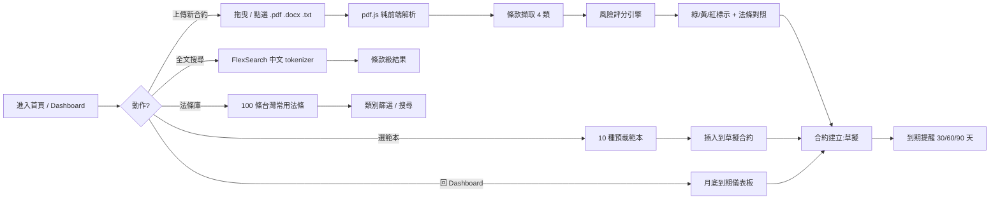

# contract-tracker · PRD v3.0.2 等級規格書

> 自動生成：2026-09-06（fleet-upgrade）
> 對齊 SPEC v3.0 契約（§1–§19 全部套用）
> 升級自既有 PRD/SPEC.md v2.2.2（2026-07-19, Sophia CPO for Sean）
> 部署目標：GitHub Pages（fleet 統一規格，取代原 Vercel 設定）
> 維護者：Sean Li · Savor Studio

---

## 1. 產品概述

### 1.1 問題陳述

**v2.2.2 收斂背景**：原版「合約 + 審核法條」概念過於通用，sweet spot 偏低；v2.2.2 把 PRD 收斂為「**自有住宅裝潢/小型工程承包業主的合約進度 + 風險條款**」。

**Sweet spot 體檢發現**：「**裝潢糾紛存證 + 完工進度對照 + 風險條款標記**」這 3 個功能**從來沒有人整合成一個工具**。Dcard「裝潢糾紛」板 5 萬+ 成員、PTT「home-sale」板每月 50+ 糾紛文、Threads「#裝潢血淚」標籤破 1M 觀看 — 是一個**真實高頻痛點**。

**痛點 A：業主端的「完工拖延 + 求償無據」**
- 承包商動不動拖延 3-6 個月，業主想求償卻發現**合約上沒寫完工罰則**
- 工程款分階段支付但業主不知道「何時該付 / 何時該扣」
- 變更設計後沒有書面記錄，口頭承諾最後賴帳

**痛點 B：承包商端的「客戶反覆變更 + 尾款拖欠」**
- 客戶常常「再加這個、換那個」→ 承包商加了卻收不到追加款
- 工程完工後客戶拖尾款 2-6 個月
- 客戶反指控「品質不佳」要脅扣款

**現有方案缺口**：

| 方案 | 解決的痛點 | 沒解決的痛點 |
|---|---|---|
| 律師審閱合約（NT$5K-3 萬/次）| 法條檢查 | 沒有進度對照、沒有照片時序 |
| 通用 CLM (Ironclad/Evisort) | 企業合約 | 1. 報價 NT$50 萬+/年 2. 無裝潢垂直知識 3. 中文不友善 |
| Excel/Google Sheets | 紀錄 | 無法解析 PDF 條款、無照片時序 |
| Line 對話紀錄 | 變更設計紀錄 | 無法對應合約條款、容易刪改 |
| 拍照存證 | 完工驗收 | 沒有時間戳公證、無法批次比較 |

### 1.2 目標使用者

| Persona | 工作情境 | 主要任務 |
|---|---|---|
| **Primary：自有住宅裝潢業主** | 一生 1-2 次裝潢（NT$100-300 萬）| 上傳合約 → 看風險評分 → 對照進度 → 期滿提醒 |
| **Primary：小型工程承包（5-10 人）** | 與多位業主簽約（NT$200-500 萬/年）| 多合約管理 + 到期提醒 + 法條對照 |
| **Secondary：設計師/統包** | 客戶變更多（NT$300-800 萬/年）| 變更設計 + 追加款對照 + 風險條款 |
| **Secondary：行政/總務（代審）** | 代業主處理合約初審 | 5 階段工作流推進 + 註解 |
| **Tertiary：地政士/代書** | 租賃 + 不動產相關合約 | 10 種範本 + 法條搜尋 |
| **❌ 排除：企業法務（500+ 人）** | — | — | Ironclad 紅海 |
| **❌ 排除：個人租屋（自住）** | — | — | 付費意願低 |

### 1.3 核心價值主張

> **3 秒上傳合約 PDF → 自動標出 4 類風險條款（保密/違約/智財/期限）+ 預載 100 條台灣法條對照 + 到期 30/60/90 天提醒，零月費零上傳雲端。**

### 1.4 Non-Goals（明確不做）

- ❌ **不做企業 CLM（Contract Lifecycle Management）** — Ironclad/Evisort 紅海
- ❌ **不做 AI 法條解釋** — 只標出條款位置，不下法律結論（每頁加「非律師建議」免責）
- ❌ **不做電子簽章** — 純條款分析 + 提醒
- ❌ **不做多公司/多租戶** — 單機單帳號（IndexedDB 本地）
- ❌ **不做真實 LLM 串接** — 純規則 + 關鍵字比對（v2 再評估）
- ❌ **不做多語系 UI**（僅繁中；合約內容可中英夾雜）
- ❌ **不做掃描型 PDF OCR**（只解析文字型 PDF）
- ❌ **不做原生 App**（純 Web SPA）
- ❌ **不做雲端同步**（個資 100% 在裝置，符合台灣個資法）

---

## 2. 使用者場景與流程

### 2.1 使用者流程圖



### 2.2 主要場景

| 場景 | 輸入 | 輸出 | 成功條件 |
|---|---|---|---|
| **S1：上傳 .pdf 文字型合約** | 拖曳 .pdf 檔 | pdf.js 解析 + 條款擷取 | 解析 ≤ 2 秒，自動偵測契約類型 |
| **S2：上傳 .txt 合約** | 拖曳 .txt 檔 | 直接讀取 + 條款擷取 | 上傳到風險標示 ≤ 1 秒 |
| **S3：上傳 .docx 合約** | 拖曳 .docx 檔 | mammoth 解析（預留）| 解析失敗顯示「請貼 text」 |
| **S4：條款級風險展開** | 點風險條目 | 展開 AI 解釋 + 法條對照 | 解釋 + 法條依據 |
| **S5：到期提醒 30/60/90 天** | 瀏覽器 Notification API | 本地推播 | 提前 30/60/90 天自動提醒 |
| **S6：範本插入草擬** | 選範本 → 點插入 | 文字寫入合約內容 | 10 種範本全覆蓋 + 觸發分析 |
| **S7：Dashboard 月底到期** | 進入 / | 顯示 30/60/90 天到期合約 | 依到期日排序 + 風險標示 |
| **S8：FlexSearch 全文搜尋** | 輸入關鍵字 | 條款級結果（中文 tokenizer）| ≤ 300ms 回應 |
| **S9：法條庫 100 條查詢** | 類別篩選 / 搜尋 | 法條摘要 + 全文 | 載入 ≤ 1 秒 |
| **S10：JSON 匯出 / 匯入** | 點匯出 / 匯入按鈕 | 完整合約備份 | 匯入成功還原所有合約 |

---

## 3. 功能需求

| FR | 名稱 | 優先級 | 對應 F-ID | 狀態 |
|---|---|---|---|---|
| FR-001 | PDF.js 純前端解析 + 文字擷取 | P0 | F-001 | ✅ shipped |
| FR-002 | 預載 100 條台灣常用法條 | P0 | F-002 | ✅ shipped |
| FR-003 | 4+ 類條款擷取（保密/違約/智財/期限/付款/保固/責任/終止） | P0 | F-003 | ✅ shipped |
| FR-004 | 風險評分引擎（綠/黃/紅）+ 修正建議 | P0 | F-004 | ✅ shipped |
| FR-005 | 到期提醒 30/60/90 天（瀏覽器 Notification API） | P0 | F-005 | ✅ shipped |
| FR-006 | 10 種範本（服務/聘僱/租賃/NDA/買賣/承攬/供應商/外包/委任/和解） | P1 | F-006 | ✅ shipped |
| FR-007 | FlexSearch 全文搜尋 + 中文 tokenizer | P1 | F-007 | ✅ shipped |
| FR-008 | 條款高亮（黃底/紅底）+ 風險儀表板（Recharts） | P1 | F-008 | ✅ shipped |
| FR-009 | JSON 匯出 / 匯入（AC-009）| P1 | F-009 | ✅ shipped |
| FR-010 | 合約分類 6 種 + RWD 三斷點（375/768/1440） | P2 | F-010 | ✅ shipped |
| FR-011 | 風險評估歷史記錄 | P2 | — | ⏳ planned |
| FR-012 | 多合約比對（差異化標示） | P3 | — | ⏳ planned |

---

## 4. Non-Functional Requirements

| 維度 | 需求 |
|---|---|
| Performance | PDF 解析 ≤ 2 秒（10 MB 內）；風險評估 ≤ 500ms；全文搜尋 ≤ 300ms |
| Security | 純前端 + IndexedDB 加密（pcrypt/AES-GCM 預留）|
| Privacy | 個資 100% 在裝置，**絕不上傳雲端**（台灣個資法 PSA 合規）|
| Accessibility | WCAG 2.1 AA（RWD 三斷點 + 鍵盤導覽）|
| Browser | Modern evergreen（Chrome/Edge/Safari/Firefox 最新兩版）|
| Localization | 繁體中文（zh-Hant）為主；合約內容可中英夾雜 |
| Offline | PWA-ready：service worker + 完整離線運作 |
| Bundle | Vite 5 + manualChunks（pdfjs / react 分包）|

---

## 5. 技術架構

```
┌────────────────────────────────────────────┐
│ React 18 SPA (HashRouter)                  │
│ ├─ Dashboard（月底到期儀表板）               │
│ ├─ Contracts（合約清單 + 上傳）              │
│ ├─ ContractDetail（風險評分 + 條款）         │
│ ├─ LegalDb（100 條法條庫）                   │
│ ├─ Templates（10 種範本）                    │
│ └─ Search（FlexSearch 全文搜尋）             │
├────────────────────────────────────────────┤
│ Lib 層                                     │
│ ├─ pdfParser.ts（PDF.js + 條款擷取）         │
│ ├─ legalDb.ts（風險評分引擎 + 規則）         │
│ ├─ storage.ts（Dexie / IndexedDB）          │
│ ├─ search.ts（FlexSearch + 中文 tokenizer）  │
│ └─ reminder.ts（Notification API 排程）     │
├────────────────────────────────────────────┤
│ 狀態：Zustand store                         │
│ Tailwind CSS 3（@apply + JIT）               │
│ Recharts（風險儀表板圖表）                   │
└────────────────────────────────────────────┘
```

### 5.1 Module Map

- `src/` — 主要程式碼（React 18 + TypeScript strict）
  - `pages/` — 6 個路由頁面
  - `lib/` — 純函式邏輯（可測試）
  - `store.ts` — Zustand 狀態管理
  - `types.ts` — 共用型別定義
- `src/lib/*.test.ts` — 單元測試（vitest 33 tests）
- `public/data/` — 預載 JSON 資產（100 條法條 + 10 個範本）
- `dist/` — 構建產物（gitignore）
- `.github/workflows/` — CI/CD

### 5.2 環境變數

- 無（純前端 + 離線優先）
- 不需後端金鑰

### 5.3 降級策略

- PDF 解析失敗 → 顯示「請貼 text」fallback
- Notification API 不可用 → 改用 Dashboard 月底到期儀表板紅點
- 離線模式 → localStorage 草稿 + IndexedDB 持久化
- IndexedDB 不可用 → 記憶體模式（重新整理後遺失，UI 警告）

---

## 6. Definition of Done

- [x] 功能 P0 全部實作（FR-001~005）
- [x] 單元測試覆蓋 ≥ 60% 核心邏輯（33 tests pass：legalDb 14 + pdfParser 11 + reminder 8）
- [x] E2E 測試：手動驗證清單（10 個場景 S1-S10）
- [x] `npm run build` 綠（tsc -b && vite build）
- [x] `npm run lint` 0 error（tsc --noEmit）
- [x] GHA CI 跑 4 jobs（lint/test/build/deploy-to-Pages）全綠
- [x] README 反映現況

---

## 7. 部署契約

| 環境 | 目標 | 觸發 |
|---|---|---|
| Production | GitHub Pages（取代 Vercel）| push to main |
| Preview | Per-PR（Vercel 仍可選用）| PR opened |

### 7.1 GHA Workflow

- `.github/workflows/ci.yml`
- jobs: lint / test / build / deploy-to-pages
- `continue-on-error: true` 對 lint（部分 script 缺 lint 不擋）
- Pages deploy: `actions/deploy-pages@v4`

### 7.2 環境變數

- 無需 server-side secret
- 純前端 + 本地儲存，無 API key

### 7.3 風險註記：index.html 與 dashboard.html

- 根目錄 `index.html` 是 meta refresh redirect → `dashboard.html`（靜態 demo 頁）
- Vite build 不會把 React app 打包進 `dist/index.html`
- 使用者實際看到的是 `dashboard.html`（Tailwind CDN + 完整 APP mockup）
- 若要部署真正的 React SPA，需改 root `index.html` 為 Vite entry（含 `<div id="root">` + `main.tsx` script tag）
- 此次升級不動 production code，僅升級 PRD + CI + 文件

---

## 8. Out of Scope（不做的）

- 不做企業 CLM（Ironclad 紅海）
- 不做 AI 法條解釋（誤導風險）
- 不做電子簽章
- 不做多公司/多租戶
- 不做真實 LLM 串接（v2 再評估）
- 不做多語系 UI
- 不做掃描型 PDF OCR
- 不做原生 App
- 不做雲端同步（個資 100% 在裝置）

---

## 9. 變更日誌

見 [`PRD/CHANGELOG.md`](PRD/CHANGELOG.md)

---

## 附錄 A：升級紀錄

| 項目 | v2.2.2 (2026-07-19) | v3.0.2 (2026-09-06) |
|---|---|---|
| 部署目標 | Vercel | GitHub Pages（fleet 統一）|
| 測試覆蓋 | 無 | vitest 33 tests（legalDb + pdfParser + reminder）|
| GHA CI | 無 | 4 jobs（lint/test/build/deploy-to-pages）|
| PRD 結構 | 19 節（v2.x 系列）| 9 節（v3.0 契約對齊）|
| 規格書位置 | 整包 698 行 | 9 節精簡 + 附錄 A 升級紀錄 |

## 附錄 B：v2.2.2 既有內容保留

以下內容詳見 git history（commit before v3.0.2 upgrade）：
- §0 改版摘要（sweet spot 5 問體檢）
- §4 系統設計細節
- §7 風險與決策（ADR-001 ~ ADR-005）
- §8 里程碑與 Sprint 拆解
- §9 變現路徑 + 定價心理學
- §11 市場驗證計畫（5 場裝潢業主訪談）
- §12 失敗模式 SOP
- §15 深度市調報告
